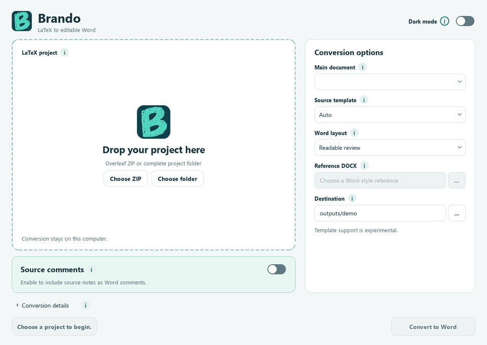

<h1> Brando</h1>

Turn an Overleaf source ZIP or LaTeX project folder into an editable Word document.
Conversion runs on your computer, with optional source comments and light or dark mode.

Created and maintained by **Giacomo Da Re**.

## Get Brando

| Your computer | Download |
| --- | --- |
| Windows, x86-64 | [Windows ZIP](https://github.com/Giacomo98DaRe/Brando-From-LaTeX-to-Word/releases/download/v0.1.0/Brando-0.1.0-win32-AMD64.zip) |
| Mac, Apple Silicon | [macOS ZIP](https://github.com/Giacomo98DaRe/Brando-From-LaTeX-to-Word/releases/download/v0.1.0/Brando-0.1.0-darwin-arm64.zip) |
| Mac, Intel | [macOS ZIP](https://github.com/Giacomo98DaRe/Brando-From-LaTeX-to-Word/releases/download/v0.1.0/Brando-0.1.0-darwin-x86_64.zip) |
| Linux, x86-64 | [Linux archive](https://github.com/Giacomo98DaRe/Brando-From-LaTeX-to-Word/releases/download/v0.1.0/Brando-0.1.0-linux-x86_64.tar.gz) |

### Windows

Extract the whole ZIP and open `Brando/Brando.exe`. Keep the extracted folder together.
Windows 11 is the tested desktop baseline. A missing runtime message has a quick fix in
the [setup guide](docs/USAGE.md#windows).

### macOS

Use the Apple Silicon or Intel ZIP for your Mac, extract it and open `Brando.app`.
Requires macOS 14+. If the first launch is blocked, use **Privacy & Security > Open Anyway**
for Brando. See [macOS setup](docs/USAGE.md#macos).

### Linux

On Ubuntu 24.04 x86-64, extract the archive, install its listed runtime libraries and start Brando.

```sh
tar -xzf Brando-0.1.0-linux-x86_64.tar.gz
sudo apt install $(cat Brando/linux-system-dependencies.txt)
./Brando/Brando
```



## From project to Word

1. **Open Brando.** Extract the whole archive, then open the Brando application.
2. **Choose your project.** Drop an Overleaf source ZIP or folder and select the main `.tex` file.
3. **Convert.** Choose the destination, enable **Source comments** if wanted and select **Convert to Word**.

The app includes Python and the conversion engine. You can start with the included `example-project`.

## Your Word document

- **Editable content** with supported text, tables, equations and references.
- **Source comments** beside matching manuscript text, with unmatched notes in **Source annotations**.
- **Conversion notes** saved beside `manuscript.docx` in a new export folder.

Review figures, equations, tables and citations before sharing. Custom templates and macros
remain experimental. Setup help, comment behavior and known limits are in the
[user guide](docs/USAGE.md).

## Feedback and development

If Brando helps your work, consider giving the repository a star on GitHub.

Report a problem or suggest an improvement through [GitHub issues](https://github.com/Giacomo98DaRe/Brando-From-LaTeX-to-Word/issues).
For setup, tests, builds and technical documentation, see [development](docs/BUILDING.md).

## License

Brando's original code is licensed under [Apache 2.0](LICENSE), with attribution in [NOTICE](NOTICE).
Dependency licenses and corresponding
sources are listed in [third-party notices](THIRD_PARTY_NOTICES.md).
