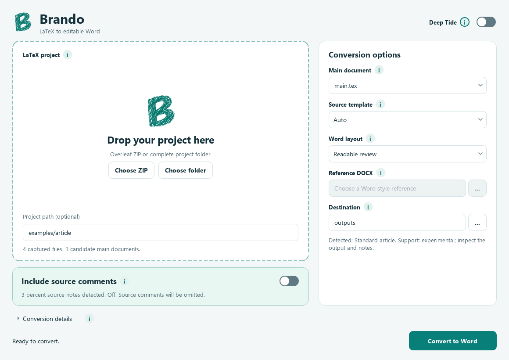
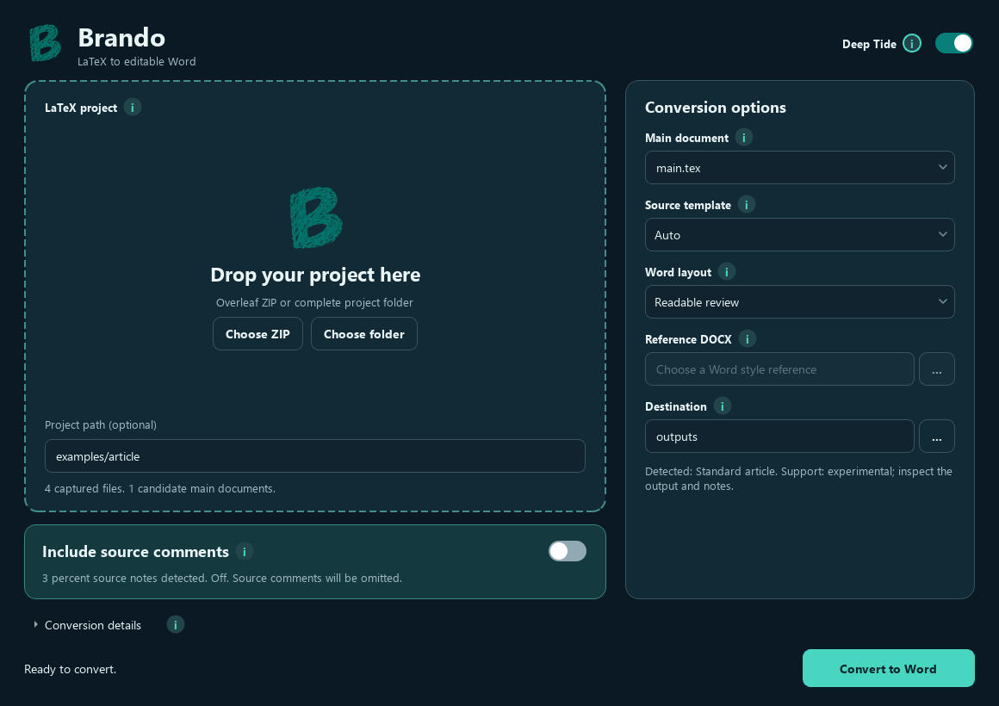

# Brando

An independent local desktop application that converts an Overleaf source ZIP or LaTeX
project folder into editable Word documents. Text, supported tables, equations, references
and source comments remain editable where supported. No account, document upload or Word
installation is needed to generate DOCX. The application does not synchronize Word edits
back to Overleaf.

**Status: local development prototype, 0.1.0. No public release or platform support claim yet.**

## Run the desktop prototype

The portable Windows development bundle is generated under `dist/Brando/`. Keep the whole
directory together, unzip it to a writable local folder and open `Brando.exe`. End users
of this bundle do not need Python, Git, Pandoc or TeX. Public installation assets have not
been published. See [build and validation instructions](docs/BUILDING.md).

1. Select or drop an Overleaf **source ZIP** or a project folder. Alternatively, paste its
   path in **Project path (optional)** and press **Enter** to load it. Moving focus alone
   does not load a typed path; conversion stays disabled while a changed path is unconfirmed.
2. Choose the main `.tex` file if there are several candidates. Convert separate supplements
   separately; independently compilable `subfiles` chapters are not automatically roots.
3. Leave source template on **Auto**, or override it. Choose readable review styling or a
   reference DOCX. Source recognition and Word styling are separate choices.
4. Optionally turn on **Include source comments**. It starts off.
   Each option has an adjacent information button. The interface shows detected note counts
   and whether comments will be exported. The default destination is `Documents/Brando_exports`.
5. Choose an output folder outside the source folder, then select **Convert to Word**.
6. Read the conversion notes and inspect the Word file before sharing it.

Each export has a fresh timestamped folder containing `manuscript.docx`,
`conversion-notes.txt` and `conversion-report.json`. Earlier exports and source files remain
unchanged. The report records input/output hashes, engine diagnostics, math coverage,
independent source observations and actual comment coverage.

The Lagoon interface starts with a large project drop area and a dedicated source-comment
control. The small **Deep Tide** slide in the header changes the color palette while preserving
the layout and conversion choices. Each new window starts in Lagoon. Information buttons
beside the options show short, wrapped help on hover or activation with the keyboard.
**Conversion details** shows session progress, warnings and errors in a read-only panel.
It becomes available after there is something to show, and opens automatically on errors
or conversion warnings. The panel explains where the saved notes and report are stored.
`conversion-notes.txt` is the readable export summary; `conversion-report.json` contains
the full diagnostic and coverage details. Both are saved beside `manuscript.docx` in the
new export folder. These diagnostics are separate from the source comments inside Word.





## Compatibility targets

| Source family | Status | Evidence / limits |
| --- | --- | --- |
| Standard article | Experimental | Synthetic nested-input, citation, table, equation and comment regressions |
| Elsevier elsarticle | Experimental | Synthetic frontmatter; official sample has missing example image/citation dependencies |
| Elsevier CAS | Experimental | Synthetic frontmatter; sample PDF figure rasterized to PNG, no full visual fidelity check |
| Springer Nature | Experimental | Checked sample authors retained; EPS figure unsupported; encoding fallback reported |
| IEEEtran | Experimental | Checked conference authors retained; synthetic affiliation/abstract/keyword checks |
| Other classes / theses | Best effort | Checked thesis chapter phrases retained; complex thesis has many unsupported macros |

The comparison against Pandoc and the evidence behind the chosen tex2word core are in
[engine evaluation](docs/ENGINE_EVALUATION.md). A successful process exit or valid DOCX XML
does not certify manuscript completeness.

## Limitations and troubleshooting

- Arbitrary TeX macros, conditionals, generated content, complex table structures and custom
  class semantics can change or omit content. Every template remains experimental.
- The first slice disables TeX subprocesses and automatic TikZ rendering. No full reference
  PDF is required or generated. Unsupported figures and image fallback appear in the notes.
- PDF figures can become PNG images; EPS figures need separate preparation. Equations use
  native Office Math where supported; raw fallbacks are reported. Review every equation.
- Percent source comments become **native Word comments beside unique matching manuscript text**.
  Unmatched notes and notes from unused `.tex`/`.bib` files use a final **Source annotations**
  appendix. The report records actual body/appendix placement and Word comment IDs. Comments
  inside literal environments are excluded. Supported inline `todo`, `comment` and `note`
  annotations use the engine's manuscript anchors. The checkbox controls both kinds. Coverage
  and counts appear in the report. Overleaf Review discussions require a separate data source.
- Missing images/bibliography/includes may be missing project dependencies. Read the report
  and add the required files before retrying. Unresolved citations remain review issues.
- A mismatch in independently checked simple-table numbers stops publication of that export.
  Complex tables are explicitly outside that check; presence checks do not prove full fidelity.
- Main-file discovery is heuristic. Select a `.tex` path manually when required.
- ZIP import rejects links, path traversal, duplicate/case-colliding paths and projects over
  200 MiB or 10,000 files. Keep resources inside the project; external resource reads are blocked.
- Conversion times out after 120 seconds by default. The developer CLI allows a different timeout.
- A reference DOCX supplies styles and page geometry; it does not reproduce arbitrary LaTeX layout.
- Microsoft Word rendering, LibreOffice rendering and clean-machine portability are separate
  acceptance checks. See [current validation evidence](docs/VALIDATION.md).

## Development

Use the pinned Python 3.12.16 and [uv](https://docs.astral.sh/uv/) in a separate environment. Do not reuse
a scientific Conda environment. From a checkout:

```powershell
uv sync --frozen --extra dev --python 3.12
.venv/Scripts/python.exe -m ruff check src tests scripts
.venv/Scripts/python.exe -m ruff format --check src tests scripts
.venv/Scripts/python.exe -m pytest
.venv/Scripts/pythonw.exe -m brando
```

Ruff is a pinned development-only tool. Use `ruff format src tests scripts` to apply the
maintained formatting. Comments explain constraints and non-obvious choices.

On macOS/Linux use `.venv/bin/python` for checks and GUI. The developer CLI is available as:

```powershell
.venv/Scripts/python.exe -m brando.cli examples/article --destination outputs
.venv/Scripts/python.exe -m brando.cli project.zip --main main.tex --destination outputs --comments
```

See [architecture](docs/ARCHITECTURE.md), [builds](docs/BUILDING.md) and
[third-party notices](THIRD_PARTY_NOTICES.md). Brando's original source is MIT licensed;
third-party components retain their own terms. Public binary distribution has outstanding
license/source-provision and validation gates. No user manuscripts or handoff corpus belong
in source control or remote CI. `history/` is ignored local working memory.
